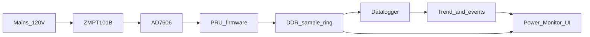

# Pika

Pika is a residential power-quality monitor that runs on a BeagleBone Black. It watches one 120 V, 60 Hz line-to-neutral channel so a homeowner can tell whether a voltage problem looks like a utility issue or an electrician issue. It is not a certified power-quality meter.

A ZMPT101B scales the mains into an AD7606 ADC. The board’s PRU samples that ADC on a hard real-time loop (discrete rates from 10 S/s to 180 kS/s). Shared RAM at `0x4A310000` is control only; samples stream through a DDR ring. The Linux datalogger turns that stream into events, a voltage trend, and the records behind flicker notes. A web UI on port 8888 shows the result.



## How it works

- **PRU firmware** (`pika/pru/`) samples the AD7606 and publishes samples in the DDR ring.
- **Datalogger** (`pika/datalogger/`) reads that ring and writes records under the data directory.
- **Web app** (`pika/webapp/`) is the Pika Power Monitor UI (FastAPI, port 8888). `make daemon-status` ([pika/scripts/pika_status.py](pika/scripts/pika_status.py)) is the operator view of the PRU, processes, disk, and `/health`. See [ADR-0005](docs/adrs/0005-operator-status-dashboard.md).

The datalogger writes three kinds of records:

- **Events.** One-cycle RMS sags below 90% of site nominal (default 120 V) and swells above 110%, held for at least about half a cycle. High-rate waveform snapshots are kept only around those events. See [ADR-0003](docs/adrs/0003-ieee-1159-sag-swell-detection.md).
- **Trend.** Continuous ~5 Hz points. Each point is about 12 cycles (~200 ms) of calibrated Vrms plus the waveform envelope. A 10-minute min/avg/max rollup gives longer ANSI C84.1 context. See [ADR-0004](docs/adrs/0004-iec-aligned-trend-decimation.md).
- **Flicker notes.** A later “the lights blinked” or “the TV dropped out” note is searched against ±2 minutes of the trend and the event index. Notes live in `observations.jsonl`, separate from event files. See [ADR-0007](docs/adrs/0007-flicker-observations.md).

Spike and dip event types, and IEC 61000-4-30 Class A certification, are out of scope.

## Web UI

- **Dashboard** (`/`) — PRU, datalogger, and web health, storage, and the voltage trend.
- **Oscilloscope** (`/oscilloscope`) — live waveform over `/ws/live`. The sample-rate control changes the physical ADC rate and restarts acquisition. See [ADR-0002](docs/adrs/0002-oscilloscope-sample-rate-control.md).
- **Events** (`/events`) — logged sags and swells, with a fixed professional-review badge (deep sag, damaging swell, interruption-class, or a sustained excursion outside utilization Range B). Log thresholds are user-tunable; the review rules are not.

Flicker notes are entered from the UI and correlated when they are read.

## Quick Start

```bash
# Clone the repository
git clone <repository-url>
cd Pika-pika

# Build PRU firmware
cd pika
make pru

# Run tests
make test-pru

# See getting started guide for hardware setup
cat docs/getting-started.md
```

## Documentation

- [Getting Started](docs/getting-started.md) — hardware setup and deployment
- [Architecture decision records](docs/adrs/README.md) — why the monitor behaves this way
- [Architecture](docs/architecture.md) — system design and data flow
- [Memory Map](docs/memory-map.md) — PRU shared memory layout
- [PRU README](pika/pru/README.md) — PRU firmware details

## License

[License information to be added]
